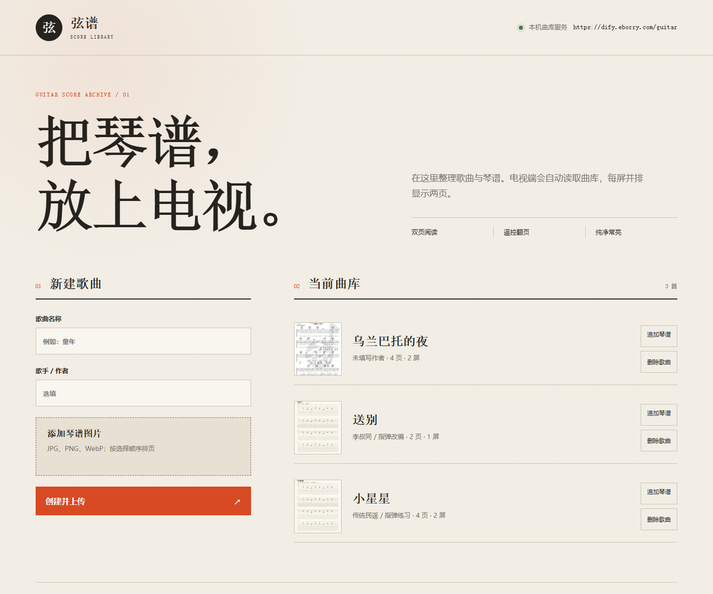
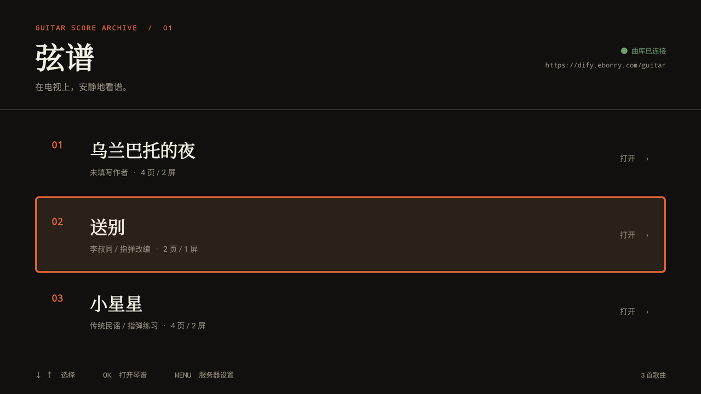
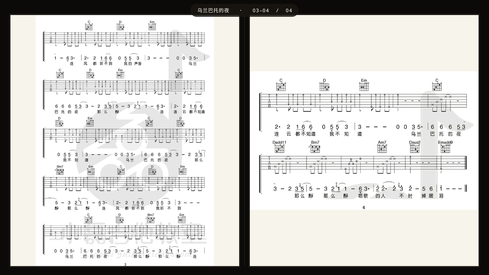
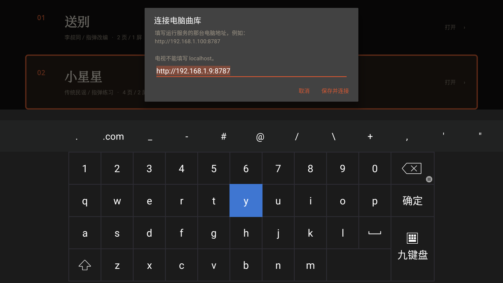
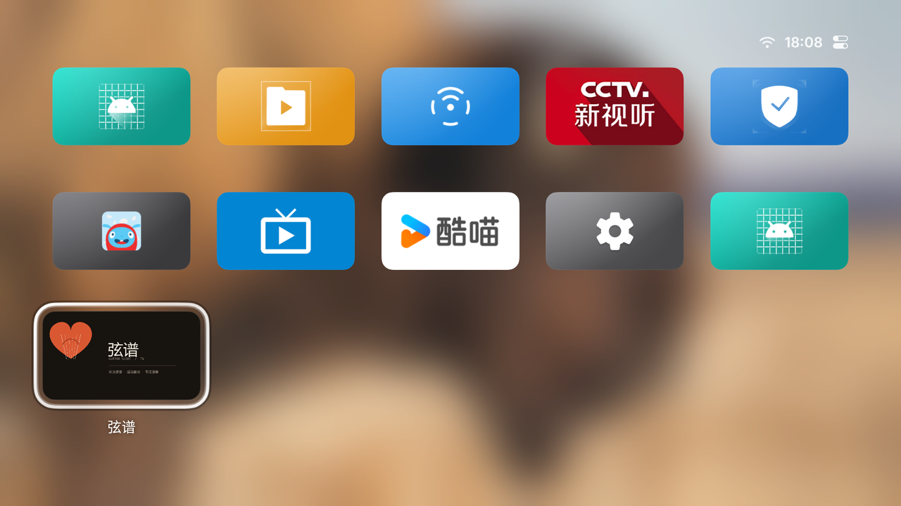

# 弦谱 GuitarScoreTV

> 把吉他谱放上电视，左右双页、遥控翻页、纯净常亮。

一套自持曲库的电视吉他谱阅读方案：浏览器后台上传歌曲与琴谱，Android TV 端像翻纸质谱本一样，
一屏并排两张琴谱，按遥控器下键翻页。没有广告、没有推荐、没有登录，只有谱。


## 为什么做这个

在电视上看吉他谱，通常要投屏图片、或举着手机放大再对着弹，屏幕一半永远是空的。
真正合用的形态应该像纸质谱本：**屏幕当两页用，一屏两页，翻页即翻纸**。
市面上没有合适的现成应用，于是做了一个——顺便把广告、弹窗、自动播放这些东西全挡在门外。

## 功能

**电视端**

- 歌曲列表，遥控器上下选歌，OK 打开；
- 每屏左右各一张琴谱，对应谱本左右页，符合看谱习惯；
- 下 / 右键下一屏，上 / 左键上一屏，BACK 返回曲库，MENU 修改服务器地址；
- 打开琴谱后保持屏幕常亮、隐藏系统栏，长时间练习不会黑屏；
- 无广告 SDK、无统计 SDK、无 WebView，只请求自己配置的曲库地址；
- 原生 Java + 自建轻量 HTTP 客户端，APK 仅 95KB，1GB 内存的老盒子也能跑。

**网页后台**

- 新建歌曲、批量上传琴谱；图片顺序即页码，按文件名排好一次全选即可；
- 追加琴谱、整首删除；
- 顶部直接显示电视端该填写的服务器地址；
- 支持根路径或子路径（如 `https://example.com/guitar/`）部署。

<p align="center">
  
</p>

## 截图

| 电视曲库 | 第二屏（第 3–4 页） |
|---|---|
|  |  |

| 服务器设置（MENU） | 桌面入口 |
|---|---|
|  |  |

## 快速开始

### 1. 起服务端

需要 Node.js 18+。

```bash
cd server
npm install
node server.js          # Windows 下也可双击 start-server.bat
```

打开 `http://localhost:8787`，后台顶部会显示电视要填的地址，例如 `http://192.168.1.9:8787`。
电视和这台机器需在同一局域网，不要填 `localhost`。

曲库数据落在 `server/data/`（`songs.json` + `uploads/`），备份复制整个目录即可。

### 2. 装电视端

```bash
adb install -r dist/GuitarScoreTV-v1.1.0.apk
```

也可以拷到 U 盘用电视文件管理器安装。首次启动填后台显示的地址，之后按 **MENU** 可随时改；
部署到公网时填 `https://你的域名/guitar`。

### 3. 加歌

后台填歌名、歌手，选中多张琴谱图片，点「创建并上传」。
支持 JPG / PNG / WebP，单张 ≤ 20MB，每首最多 60 页。

## 目录结构

```text
server/            Node.js 服务端 + 网页管理后台
  server.js        Express 应用（支持 BASE_PATH 子路径部署）
  public/          管理后台前端（原生 HTML/CSS/JS）
  data/            运行时曲库数据（不入库）
tv-app/            Android TV 客户端
  app/src/main/java/com/gavin/scoretv/
    MainActivity.java    歌曲列表与服务器配置
    ReaderActivity.java  双页阅读、翻页、常亮
    Song.java            歌曲模型与图片地址解析
    ApiClient.java       轻量 HTTP 客户端
deploy/            systemd 单元与 Nginx 反代片段
dist/              可安装的发布版 APK
docs/              部署文档与产品截图
testdata/          双页排版测试用琴谱与图标生成脚本
```

## 遥控器操作

| 按键 | 操作 |
|---|---|
| 上 / 下 | 歌曲列表移动 |
| OK | 打开琴谱 |
| 下 / 右 | 下一屏（两页） |
| 上 / 左 | 上一屏 |
| BACK | 返回列表（保持原选中歌曲） |
| MENU | 修改服务器地址 |

## 构建电视端

需要 JDK 17、Android SDK Platform 34；在 `tv-app/local.properties` 里写 `sdk.dir`。

```bash
cd tv-app
./gradlew assembleRelease     # Windows: gradlew.bat assembleRelease
```

产物：`tv-app/app/build/outputs/apk/release/app-release.apk`。
仓库 `dist/` 里的版本使用开发证书签名以便侧载，自行分发请换成正式签名。

## 服务端配置

| 环境变量 | 说明 | 默认 |
|---|---|---|
| `PORT` | 监听端口 | `8787` |
| `HOST` | 监听地址 | `0.0.0.0` |
| `BASE_PATH` | 子路径前缀，如 `/guitar` | 空（根路径） |
| `DATA_DIR` | 数据目录 | `./data` |
| `ADMIN_TOKEN` | 管理密码，设置后写入/删除需带 `X-Admin-Token` | 空 |

## 接口

子路径部署时统一带 `/guitar` 前缀；根路径部署去掉前缀即可。

| 方法 | 路径 | 用途 |
|---|---|---|
| GET | `/api/health` | 健康检查，返回当前 `basePath` |
| GET | `/api/songs` | 歌曲列表 |
| GET | `/api/songs/:id` | 单首歌曲 |
| POST | `/api/songs` | 新建歌曲，multipart：`title`、`artist`、`images` |
| POST | `/api/songs/:id/images` | 追加琴谱图片 |
| DELETE | `/api/songs/:id` | 删除歌曲与图片 |
| GET | `/uploads/<文件名>` | 琴谱原图 |

返回的图片地址是带前缀的绝对路径（如 `/guitar/uploads/xxx.jpg`），
客户端应按站点根解析，而不是当相对路径拼接。

## 部署到服务器

子路径反代 + systemd 常驻配置见 [docs/DEPLOY.md](docs/DEPLOY.md)。

## 已验证环境

MagicBox_M30_F（YunOS / Android 10，1920×1080，1GB RAM，Allwinner H616）：

- 线上 HTTPS 地址可拉取列表、加载琴谱、翻页；
- 每屏左右两页，四页谱连续翻页无残图、无黑屏；
- 返回列表保持原歌曲选中；
- 阅读页窗口持有 `KEEP_SCREEN_ON`，系统栏为 `IMMERSIVE_STICKY`；
- 连续操作无崩溃，阅读页 PSS 约 58MB。

## 已知限制

- 电视端只能保证自身不展示广告，无法拦截固件或其他应用弹出的系统级悬浮广告；
- 曲库为单机 JSON 文件存储，适合个人/小团队；多实例部署需把上传目录换成共享存储；
- 后台默认无鉴权，公网部署建议设置 `ADMIN_TOKEN`，或只在内网开放。

## 许可

未附带开源许可证文件；如需二次分发，请先与作者确认授权方式。
