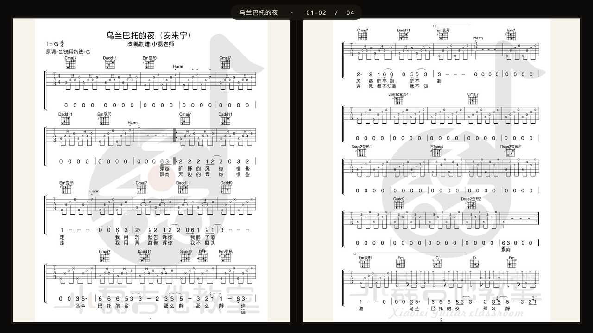

# 弦谱 GuitarScoreTV

[](https://github.com/qilin892/GuitarScoreTV/releases/latest)
[](dist)

电视上看吉他谱。后台传谱，电视上一屏两页，遥控器翻页。



## 功能

电视端：

- 歌曲列表，上下键选，OK 打开
- 一屏左右各一页，对应谱本左右页
- 下键 / 右键下一屏，上键 / 左键上一屏，BACK 回列表，MENU 改服务器地址
- 阅读时屏幕常亮、隐藏系统栏
- 无广告 SDK、无统计 SDK、无 WebView，只访问自己配的地址
- 原生 Java，APK 95KB，1GB 内存的盒子能跑

后台：

- 新建歌曲、批量传图，图片顺序就是页码
- 追加琴谱、删歌
- 顶部显示电视端该填的地址
- 可以部署在根路径，也可以部署在 `/guitar/` 这类子路径

截图：[后台](docs/screenshots/web-admin.png)、[曲库](docs/screenshots/tv-library.png)、[第二屏](docs/screenshots/tv-reader-page2.png)、[设置](docs/screenshots/tv-settings.png)、[桌面入口](docs/screenshots/tv-launcher.png)

## 快速开始

服务端要 Node.js 18+。

```bash
cd server
npm install
node server.js
```

Windows 也可以双击 `server/start-server.bat`。

打开 `http://localhost:8787`，后台顶部会显示电视要填的地址，比如 `http://192.168.1.9:8787`。
电视和电脑要在同一个局域网，别填 `localhost`。

装电视端：

```bash
adb install -r dist/GuitarScoreTV-v1.1.0.apk
```

或者从 [Releases](https://github.com/qilin892/GuitarScoreTV/releases/latest) 下 APK，拷 U 盘进电视装。
第一次启动填地址，之后按 MENU 能改。

曲库存放在 `server/data/`，备份这个目录就够了。

## 按键

| 按键 | 作用 |
|---|---|
| 上 / 下 | 列表移动 |
| OK | 打开琴谱 |
| 下 / 右 | 下一屏 |
| 上 / 左 | 上一屏 |
| BACK | 回列表 |
| MENU | 改服务器地址 |

## 目录

```text
server/    服务端 + 网页后台
  server.js   Express 应用，支持 BASE_PATH 子路径
  public/     后台页面
  data/       曲库数据（不入库）
tv-app/    Android TV 客户端
deploy/    systemd 单元、Nginx 反代片段
dist/      APK
docs/      部署说明、截图
testdata/  测试琴谱
```

## 构建

JDK 17 + Android SDK Platform 34，`tv-app/local.properties` 里写 `sdk.dir`。

```bash
cd tv-app
./gradlew assembleRelease
```

产物在 `tv-app/app/build/outputs/apk/release/app-release.apk`。
仓库里的 APK 用开发证书签名，方便侧载；要分发就换成自己的签名。

## 服务端配置

| 变量 | 说明 | 默认 |
|---|---|---|
| `PORT` | 端口 | `8787` |
| `HOST` | 监听地址 | `0.0.0.0` |
| `BASE_PATH` | 子路径，如 `/guitar` | 空 |
| `DATA_DIR` | 数据目录 | `./data` |
| `ADMIN_TOKEN` | 管理密码，设了之后写操作要带 `X-Admin-Token` | 空 |

## 接口

子路径部署时带 `/guitar` 前缀，根路径部署没有。

| 方法 | 路径 | 说明 |
|---|---|---|
| GET | `/api/health` | 健康检查 |
| GET | `/api/songs` | 歌曲列表 |
| GET | `/api/songs/:id` | 单首 |
| POST | `/api/songs` | 新建，multipart：`title`、`artist`、`images` |
| POST | `/api/songs/:id/images` | 追加图片 |
| DELETE | `/api/songs/:id` | 删除 |
| GET | `/uploads/<文件名>` | 琴谱原图 |

图片地址返回的是带前缀的绝对路径（`/guitar/uploads/xxx.jpg`），客户端按站点根解析，别当相对路径拼。

部署到服务器见 [docs/DEPLOY.md](docs/DEPLOY.md)。

## 测试环境

天猫魔盒 M30_F（YunOS / Android 10，1920×1080，1GB 内存，H616）：

- 列表、双页显示、连续翻页正常，无残图无黑屏
- 返回列表停在原来那首
- 阅读页有 `KEEP_SCREEN_ON`，系统栏隐藏
- 无崩溃，阅读页内存约 58MB

## 限制

- 只能保证 App 自己不弹广告，管不了电视固件或其他应用的悬浮广告
- 曲库是单个 JSON 文件，适合个人用；要多实例得换共享存储
- 后台默认没有鉴权，放公网建议设 `ADMIN_TOKEN`

## 许可

没附开源协议。要二次分发先跟作者说一声。
